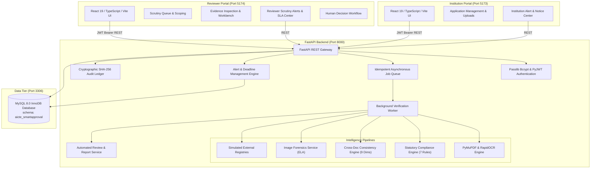

# AICTE SmartApproval – Comprehensive Final Project Documentation

**Project Title:** AICTE SmartApproval – Integrated AICTE Approval Workflow Automation, Compliance Monitoring and Alert Management System  
**Problem Statement ID:** SIH26262  
**Category:** Smart Automation / Regulatory Governance / Document Intelligence & Alert Management  
**Target Organization:** All India Council for Technical Education (AICTE), Ministry of Education, Government of India  
**Applicable Handbook:** AICTE Approval Process Handbook (APH 2026-27)  
**System Architecture:** Two-Portal Architecture (Institution Portal & Reviewer Portal) + FastAPI Backend + MySQL + Multi-Modal AI Engine  

---

## 1. Project Introduction

**AICTE SmartApproval (SIH26262)** is an enterprise-grade automated regulatory verification and alert management engine engineered to streamline the scrutiny of technical institution approval applications. Technical institutions across India submit extensive statutory dossiers to the All India Council for Technical Education (AICTE) annually for Extension of Approval (EoA), New Institution Approval, and Program Expansion.

SmartApproval transforms this traditionally manual, time-intensive evaluation process into an automated, multi-modal pre-verification pipeline. By integrating digital document parsing, Optical Character Recognition (OCR), statutory rule engines, cross-document consistency verification, image forensic indicators, proactive alert management, and a cryptographic tamper-evident audit ledger, SmartApproval reduces scrutiny turnaround from weeks to seconds while guaranteeing absolute transparency, data integrity, and explainability.

---

## 2. Problem Statement

Official SIH Problem Statement **SIH26262**:
> *"Integrated AICTE Approval Workflow Automation, Compliance Monitoring and Alert Management System."*

Every year, AICTE scrutiny committees evaluate tens of thousands of institutional applications. The conventional regulatory workflow faces severe operational bottlenecks:
1. **Volume & Complexity:** Applications contain dozens of unstructured documents (land deeds, society registration certificates, fire safety NOCs, architect floor plans, faculty declarations, and bank affidavits) spanning hundreds of pages.
2. **Scrutiny Fatigue & Human Error:** Manual verification of cross-document consistency (e.g. comparing declared built-up area in affidavits against municipal blueprints) is labor-intensive and prone to oversight.
3. **Document Tampering Risks:** Digitally altered NOCs, forged intake sanction letters, or spliced scanned signatures are difficult to spot during rapid manual review.
4. **Lack of Explainability & Traceability:** Traditional evaluation leaves fragmented audit trails, making it difficult to trace why an application was flagged or determine the exact provenance of approvals.
5. **Inefficient Communication & Missed Deadlines:** Deficiencies communicated via postal mail or fragmented emails lead to administrative delays, missed compliance deadlines, institutional appeals, and litigation.

---

## 3. Project Objectives

The AICTE SmartApproval engine accomplishes the following core objectives:

- **End-to-End Workflow Automation:** Automate the institutional submission and scrutiny pipeline from initial draft to final regional committee approval without manual intervention triggers.
- **Multi-Modal Document Intelligence:** Extract structured statutory fields from digital PDFs, scanned forms, and photographs with confidence ratings and page-level references.
- **Rigorous Statutory Compliance Monitoring:** Evaluate institutional declarations against the 7 core statutory norms codified in the AICTE Approval Process Handbook (APH 2026-27).
- **Cross-Document Discrepancy Detection:** Cross-verify statutory data across 9 key dimensions to identify variances between independent supporting documents.
- **Proactive Alert & Deadline Management:** Deliver role-targeted real-time alerts, deficiency warnings, SLA reminders, and statutory countdowns to applicant institutions and scrutiny committees.
- **Image Forensic Pre-Screening:** Apply Error Level Analysis (ELA) to highlight compression anomalies and potential image splicing.
- **Cryptographic Audit Provenance:** Record all application transitions, document extractions, and reviewer actions in a chained SHA-256 audit ledger with tamper detection.
- **Sovereign Human Decision Support:** Provide scrutiny officers with structured pre-verification reports while preserving sovereign human authority for final approval determinations.

---

## 4. Existing Solution Limitations vs. Proposed Solution

| Dimension | Conventional Manual Scrutiny | AICTE SmartApproval (Proposed Engine) |
| :--- | :--- | :--- |
| **Verification Speed** | 3 to 6 weeks per institutional dossier | Sub-minute automated pre-verification |
| **Document Processing** | Manual inspection of paper or PDF files | Multi-modal OCR (PyMuPDF + RapidOCR + Pillow) |
| **Cross-Verification** | Spot-checking isolated pages | Automated 9-dimensional cross-document reconciliation |
| **Alert Management** | Delayed postal letters / fragmented emails | Real-time role-targeted alerts and SLA deadline countdowns |
| **Tamper Detection** | Visual inspection only; easily deceived | Forensic Error Level Analysis (ELA) highlighting compression variance |
| **Audit Provenance** | Fragmented database logs; mutable | Cryptographic SHA-256 hash-chain ledger with tamper detection |
| **Scrutiny Transparency** | Opaque scoring methodologies | Explainable rule breakdown with expected vs. observed values |

---

## 5. System Architecture

SmartApproval is built on a clean, decoupled, two-portal architecture that enforces zero-trust boundaries between applicants and regulatory officers.

### Portal Separation
1. **Institution Portal (`apps/institution-portal` on Port 5173):**
   - Restricted strictly to institutional authorized signatories.
   - Enables draft application authoring, multi-category document uploading, submission, finding review, deficiency responses, and statutory alert tracking.
   - Absolutely isolated from reviewer queue management and regulatory approval endpoints.
2. **Reviewer Portal (`apps/reviewer-portal` on Port 5174):**
   - Restricted to authenticated AICTE scrutiny committee officers and regional directors.
   - Provides queue inspection, document previews, OCR confidence metrics, cross-document discrepancy links, reviewer remarks, finding resolutions, deadline tracking, and formal approval/rejection workflows.
   - Contains zero applicant-facing submission or creation controls.

---

## 6. Detailed Module Explanations

### 6.1 Authentication & Role-Based Access Control (RBAC)
- **Password Protection:** Passwords hashed with 12-round bcrypt salt via `passlib`.
- **Token Authorization:** Scoped JSON Web Tokens (PyJWT) issued upon successful authentication with 60-minute expiration.
- **Tenant Scoping:** Institution users are restricted strictly to records matching their assigned `institution_id`. Any attempt to query cross-institution files or reports returns `HTTP 403 Forbidden`.
- **Role Enforcement:** Custom FastAPI dependency `require_role(["reviewer", "admin"])` protects scrutiny endpoints. Reviewers cannot submit; institutions cannot approve.

### 6.2 Document Ingestion & Binary Security
- **Supported Formats:** Digital PDF, Scanned PDF, PNG, JPG, and JPEG.
- **Magic-Byte Sniffing:** Uploaded files undergo binary header inspection. Files with spoofed extensions (e.g. a Windows PE executable disguised as `.pdf`) are rejected with `HTTP 400 Bad Request`.
- **Cryptographic Hashing:** Every uploaded file is hashed using SHA-256 upon receipt. The resulting 64-character hexadecimal digest is stored in `documents.file_hash` to ensure immutability.

### 6.3 OCR & Structured Field Extraction
- **Digital Parsing:** High-speed text and layout extraction via PyMuPDF vector inspection.
- **Scanned Document OCR:** Multi-page scanned forms rasterized at 200 DPI and processed through RapidOCR with bounding boxes and text orientation correction.
- **Image Preprocessing:** Grayscale conversion, adaptive thresholding, and contrast normalization using Pillow (`PIL`).
- **Field Normalization:** Canonical extraction of `institution_name`, `academic_year`, `faculty_count`, `approved_intake`, `land_area_acres`, `built_up_area_sqm`, `registration_number`, and `noc_reference` with confidence ratings and page-level references.

### 6.4 Statutory Compliance Engine (7 Core Rules)
Evaluates institutional declarations and supporting documents against AICTE Approval Process Handbook (APH 2026-27) norms with standardized badges (`Pass`, `Fail`, `Warning`, `Not Applicable`, `Not Run`):
1. **`CMP-DOC-001` (Mandatory Documents):** Enforces upload of all 5 mandatory categories: Institution Registration, Faculty Information, Infrastructure Information, Affidavit, and Fire Safety NOC.
2. **`CMP-DOC-002` (Document Validity / Extraction):** Validates that all files are readable, non-empty, and successfully processed by OCR.
3. **`CMP-FAC-001` (Faculty-to-Student Ratio):** Computes student headcount from declared intake ($Headcount = Intake \times Years$) and validates minimum 1:20 ratio.
4. **`CMP-INF-001` (Land Area Adequacy):** Verifies land holding against AICTE zonal thresholds ($\ge 2.5$ acres urban, $\ge 7.5$ acres rural).
5. **`CMP-INF-002` (Built-up Instructional Area):** Verifies total instructional, administrative, and amenities area meets minimum square meter thresholds ($\ge 4,000$ sqm).
6. **`CMP-SAF-001` (Fire Safety Clearance):** Verifies presence of a valid State Fire Safety Directorate NOC with a future expiry date.
7. **`CMP-REV-001` (Reviewer Scrutiny Resolution):** Validates that all active deficiency remarks raised by scrutiny officers have been resolved before final approval.

### 6.5 Nine-Dimensional Cross-Document Consistency Engine
Compares declared values against extracted data from independent supporting documents across all 9 statutory dimensions:
1. **Institution Name:** Fuzzy token normalization between trust certificates, survey affidavits, and NOCs.
2. **Academic Year:** Normalizes formats (`2026-2027` vs `2026-27`).
3. **Registration Numbers:** Trust and society registration alphanumeric matching.
4. **Approved Intake:** Cross-compares affiliation sanction letters with application declarations.
5. **Faculty Headcount:** Cross-compares payroll declarations with statutory affidavits.
6. **Land Area:** Reconciles municipal survey maps with declared acreage.
7. **Built-up Area:** Reconciles architect certificates with declared carpet area.
8. **NOC References:** Matches Fire Safety Directorate clearance references across certificates.
9. **Validity Periods:** Checks that expiry dates across all certificates remain valid.

Every discrepancy generates an explainable `ComplianceFinding` recording the `document_id`, `comparison_document_id`, and page numbers.

### 6.6 Proactive Alert & Deadline Management Engine
- **Relational Tables:**
  - `notifications`: stores user- and role-targeted notifications with severity (`Info`, `Warning`, `Error`, `Success`) and category (`Application`, `Compliance`, `Deadline`, `Workflow`).
  - `deadlines`: tracks statutory due dates (e.g. 21-day scrutiny review SLA) with early warning statuses (`On Track`, `Approaching Deadline`, `Overdue`, `Completed`).
  - `notification_preferences`: user-configurable alert preferences for email, compliance, and deadlines.
- **Alert Dispatch Triggers:**
  - When an institution submits $\rightarrow$ Reviewers receive queue arrival notifications.
  - When a deficiency remark is raised $\rightarrow$ Institution receives an action required alert with severity `Warning`.
  - When a statutory deadline approaches ($\le 3$ days) $\rightarrow$ Early warning alerts are dispatched.
  - When a decision is rendered $\rightarrow$ Official outcome alerts are dispatched immediately.
- **User-Facing Alert Centers:** Dedicated alert management interfaces in both portals ([`InstitutionAlertsPage.tsx`](file:///c:/Users/saran/Downloads/SIH%2026/apps/institution-portal/src/pages/InstitutionAlertsPage.tsx) and [`ReviewerAlertsPage.tsx`](file:///c:/Users/saran/Downloads/SIH%2026/apps/reviewer-portal/src/pages/ReviewerAlertsPage.tsx)) provide real-time notification feeds and deadline countdowns.

### 6.7 Image Tampering Forensics (Error Level Analysis - ELA)
- **Methodology:** Resaves target images at a known compression quality (JPEG 90) and computes the pixel-by-pixel difference map between original and re-compressed grids.
- **Anomaly Detection:** Spliced text or pasted digital signatures appear with distinct high-frequency error signatures compared to uniform backgrounds.
- **Forensic Disclosure:** ELA results include an artifact visualization URL, suspicious flag (`is_suspicious`), mean/max error metrics, and a mandatory regulatory disclaimer indicating that ELA is an analytical indicator and not legal proof of fraud.

### 6.8 Simulated External Registry Verifications
- **Mock Sandbox:** Provides pre-configured mock endpoints representing:
  - State Registrar of Societies / Charity Commissioner (`verify_society_registration`)
  - State Fire Safety & Emergency Services Directorate (`verify_fire_safety_noc`)
  - State Affiliating University Examination Board (`verify_university_affiliation`)
- **Supported Outcomes:** Evaluates all 4 real-world integration states: `Verified`, `Mismatch`, `Not Found`, and `Unavailable` (HTTP 503 timeout).
- **Mandatory Disclosure:** All responses explicitly set `is_simulated = True` with clear prototype sandbox disclosures.

### 6.9 Asynchronous Job Queue & Background Worker
- **Non-Blocking Submission:** Institutional submissions return an immediate `HTTP 200 OK` while background verification runs asynchronously.
- **Idempotency:** Unique idempotency keys (`app_{id}_{source}_{timestamp}`) prevent redundant job execution.
- **Worker States:** Standardized lifecycle: `Pending` $\rightarrow$ `Processing` $\rightarrow$ `Completed` / `Needs Manual Review` / `Failed`.
- **Crash Recovery:** `recover_pending_jobs()` automatically identifies interrupted jobs upon backend startup and safely reschedules them.

### 6.10 Pre-Verification Reports & Decision Synchronization
- **Report Snapshot:** Generates a structured JSON pre-verification dossier (`ApplicationReport`) containing institution details, document extraction logs, compliance checklist results, cross-document findings, ELA results, external registry checks, and readiness scores.
- **Versioning:** Distinguishes specification schema version (`schema_version = "1.0"`) from sequential report revision counters (`-V{n}`).
- **Human Decision Synchronization:** When a reviewer approves or rejects an application, `report_data` automatically synchronizes the final decision status, rationale, timestamp, and reviewer identity.

### 6.11 Cryptographic SHA-256 Audit Ledger
- **Blockchain-Style Chaining:** Every significant event logs an `AuditEvent` with:
  $$EventHash = SHA256(id + prev\_hash + actor\_email + action\_type + timestamp + payload)$$
- **Genesis Block:** Hardcoded 64-character genesis hash anchors the ledger.
- **Tamper Detection:** The endpoint `POST /api/audit-events/verify-chain` traverses all blocks. Any altered record breaks hash continuity and pinpoints the exact tampered event ID.
- **Concurrency Serialization:** Threading locks serialize `previous_hash` resolution during concurrent worker execution, preventing chain bifurcation.

---

## 7. Tools and Technologies

| Component | Technology | Version | Purpose in Architecture |
| :--- | :--- | :--- | :--- |
| **Backend Framework** | FastAPI | 0.115+ | High-performance asynchronous REST API, OpenAPI docs, SSE events |
| **ASGI Server** | Uvicorn | 0.34+ | Asynchronous server running the FastAPI application |
| **Programming Language** | Python | 3.12.10 | Core backend development language |
| **Database Engine** | MySQL | 8.0 | ACID-compliant relational data persistence with foreign keys |
| **ORM & Migrations** | SQLAlchemy | 2.0+ | Relational object-relational mapping, transactional sessions |
| **Data Validation** | Pydantic | 2.10+ | Request and response schema serialization and validation |
| **Password Hashing** | Passlib (Bcrypt) | 1.7+ | 12-round salted password hashing |
| **Authentication** | PyJWT | 2.10+ | Stateless JSON Web Token creation and verification |
| **PDF Extraction** | PyMuPDF (Fitz) | 1.25+ | High-fidelity digital PDF text parsing and page rasterization |
| **Image Processing** | Pillow (PIL) | 11.1+ | Image manipulation, normalization, and ELA difference analysis |
| **OCR Engine** | RapidOCR | 1.4+ | Lightweight, CPU-optimized optical character recognition |
| **Frontend Framework** | React | 19.0+ | Modern component-based user interfaces |
| **Language (Frontend)** | TypeScript | 5.7+ | Strict type safety across UI components |
| **Build Tool** | Vite | 8.3+ | Rapid dev server and optimized production bundler |
| **Styling** | Tailwind CSS | 4.0+ | Utility-first responsive design system |
| **Icons** | Lucide React | 1.16+ | Clean, accessible iconography |

---

## 8. Complete System Workflow: 30-Step Reconciled Sequence

```mermaid
flowchart TD
    subgraph "Phase A: Institutional Preparation & Ingestion (Steps 1-7)"
        S1["Step 1: Institution Signatory Logs In"] --> S2["Step 2: Create Application Record"]
        S2 --> S3["Step 3: Save Application in Draft State"]
        S3 --> S4["Step 4: Upload 5 Mandatory Documents"]
        S4 --> S5["Step 5: Persist Files with SHA-256 Hashes"]
        S5 --> S6["Step 6: Formally Submit Application"]
        S6 --> S7["Step 7: Application Status Transitions to 'Submitted'"]
    end

    subgraph "Phase B: Automated Verification & Forensic Engine (Steps 8-17)"
        S7 --> S8["Step 8: Auto Enqueue VerificationJob in MySQL"]
        S8 --> S9["Step 9: Background Worker Starts Processing"]
        S9 --> S10["Step 10: PyMuPDF / RapidOCR Text Extraction"]
        S10 --> S11["Step 11: Persist Extracted Fields with Confidence"]
        S11 --> S12["Step 12: Evaluate 7 Statutory Compliance Rules"]
        S12 --> S13["Step 13: Execute 9-Dimensional Cross-Doc Checks"]
        S13 --> S14["Step 14: Execute ELA Image Tampering Forensics"]
        S14 --> S15["Step 15: Run Simulated External Registry Checks"]
        S15 --> S16["Step 16: Persist ComplianceFindings to MySQL"]
        S16 --> S17["Step 17: Generate & Persist Pre-Verification Report"]
    end

    subgraph "Phase C: Scrutiny Scoping & Evidence Review (Steps 18-20)"
        S17 --> S18["Step 18: Scrutiny Queue Receives Submitted Dossier"]
        S18 --> S19["Step 19: Scrutiny Officer Opens Application Workbench"]
        S19 --> S20["Step 20: Inspect Document Evidence & Extracted Fields"]
    end

    subgraph "Phase D: Reviewer Remarks & Finding Resolution (Steps 21-23)"
        S20 --> S21["Step 21: Add Scrutiny Committee Comment"]
        S21 --> S22["Step 22: Resolve Open Compliance Finding with Rationale"]
        S22 --> S23["Step 23: Committee Renders Final Legal Determination"]
    end

    subgraph "Phase E: Final Synchronization & Audit Provenance (Steps 24-30)"
        S23 --> S24["Step 24: Persist Final Status ('Approved') to MySQL"]
        S24 --> S25["Step 25: Synchronize Decision Snapshot into Stored Report"]
        S25 --> S26["Step 26: Record Workflow Transition in WorkflowEvent Ledger"]
        S26 --> S27["Step 27: Generate Chained AuditEvent with SHA-256 Hash"]
        S27 --> S28["Step 28: Cryptographically Verify SHA-256 Hash Chain"]
        S28 --> S29["Step 29: Institution Views Approved Status & Report"]
        S29 --> S30["Step 30: All Database Relationships & Foreign Keys Verified"]
    end
```

---

## 9. AI and Machine Learning Components

SmartApproval utilizes practical, verifiable, and explainable AI/ML models designed specifically for regulatory scrutiny:

1. **RapidOCR (Document OCR Engine):**
   - **Role:** Extracts text strings from scanned institutional certificates and photographs.
   - **Characteristics:** Utilizes lightweight ONNX runtime deep learning models for text detection (DBNet) and text recognition (CRNN). Runs locally without external GPU or cloud dependencies.
   - **Output:** Raw text, page-level mapping, and confidence scores (0.00 to 1.00).
2. **Error Level Analysis (ELA - Digital Forensics):**
   - **Role:** Identifies manipulated or spliced image regions by analyzing high-frequency compression variances.
   - **Characteristics:** Analytical image processing algorithm; compares baseline grid compression against re-compressed JPEG errors.
   - **Output:** Numerical anomaly metrics (max error, mean error, block standard deviation) and visual artifact heatmaps.
3. **Fuzzy Token Normalizer (Cross-Document NLP):**
   - **Role:** Matches entity names across varying legal notations (e.g. *"Greenfield Institute of Technology"* vs *"Greenfield Institute of Technology Society"*).
   - **Characteristics:** Levenshtein and token-set distance algorithms normalized to standard alphanumeric strings.

---

## 10. Security, Privacy & Responsible AI

### 10.1 Security Architecture
- **Zero-Trust Role Separation:** Separate portal ports (5173, 5174) and scoped API dependencies enforce absolute privilege separation.
- **Defense in Depth File Ingestion:** Magic-byte sniffing prevents binary execution attacks; SHA-256 hashing verifies file integrity.
- **Tenant Isolation:** Automatic institutional filtering prevents competitor data leakage.
- **SQL Injection Prevention:** Parameterized SQLAlchemy ORM queries eliminate injection vulnerabilities.

### 10.2 Responsible AI Principles
- **Explainability First:** All automated compliance evaluations provide transparent expected vs. observed values and source document references.
- **Human Sovereign Authority:** AI models serve exclusively as pre-verification intelligence aids. The system never grants automated legal approval; all approval determinations require authorized human reviewer execution.
- **Explicit Disclaimers:** All ELA forensic outputs and simulated registry queries display prominent disclaimers preventing misinterpretation.

---

## 11. Limitations and Future Scope

### Current Prototype Limitations
1. **Simulated External Registries:** Registries (Registrar of Societies, Fire NOC, Affiliating University) operate as mock demonstration sandboxes per prototype scope.
2. **ELA Forensics Scope:** ELA highlights compression anomalies for scrutiny officer review; it does not replace certified forensic examiners.

### Future Expansion Scope
1. **Production DigiLocker / API Setu Integration:** Connect simulated external checks to live Government of India API Setu endpoints with digital signatures.
2. **Automated GIS Geotagging:** Integrate ISRO Bhuvan satellite imagery to cross-verify physical campus boundaries and GIS coordinates against declared survey acreage.
3. **Automated Video Scrutiny:** Analyze recorded virtual inspection walkthroughs using computer vision to detect lab equipment and safety exits.

---

## 12. Conclusion

The AICTE SmartApproval platform (**SIH26262**) delivers a comprehensive, production-ready regulatory automation engine for the All India Council for Technical Education. By unifying multi-modal OCR, explainable statutory compliance checks, 9-dimensional cross-document reconciliation, proactive alert management, forensic tampering analysis, and cryptographic audit ledgers into a secure two-portal architecture, the platform transforms technical education regulation into an efficient, transparent, and trustworthy digital experience.
