# AICTE SmartApproval – Phase 4, 5 & 6 Final Consolidated Correction and Verification Report

**Project:** AICTE SmartApproval – Multi-Modal Trust Engine for Application Validation  
**Project Code:** SIH26261  
**Scope Covered:** Phase 4 (Compliance, Consistency, Image Forensics, External Verification), Phase 5 (Reviewer Workbench, Human Decision Workflow), Phase 6 (Reports, Audit Trail, Security, Reliability)  
**Specification Authority:** `AICTE_SmartApproval_Complete_Project_Report.pdf` (Single Source of Truth)  
**Execution Timestamp:** 2026-10-30T17:44:40 UTC  
**Environment:** Python 3.12 (FastAPI), MySQL 8.0, Node.js v20 (Vite / React / TypeScript)  

---

## 1. Executive Summary

A comprehensive forensic inspection of the codebase across Phases 4, 5, and 6 was conducted to identify, diagnose, and resolve all reported inconsistencies, edge-case defects, and verification gaps. A consolidated 19-stage verification test harness (`scratch/test_phase_4_5_6_consolidated.py`) was executed against the running backend and live MySQL database.

**Key Outcome Summary:**
- **Consolidated Test Harness:** **19 / 19 Tests Passed (100% Success Rate)**.
- **Evidence Persistence:** Raw structured test evidence persisted to [`scratch/phase_4_5_6_final_evidence.json`](file:///c:/Users/saran/Downloads/SIH%2026/scratch/phase_4_5_6_final_evidence.json).
- **Statutory Compliance:** All 7 AICTE statutory rules evaluated with standardized badges; counts strictly reconcile with persisted `ApplicationReport` fields.
- **Cross-Document Consistency:** 9 statutory dimensions verified with explainable document linking (source document ID, comparison document ID, and page references).
- **Image Tampering Detection:** Error Level Analysis (ELA) verified across clean, spliced, and corrupted targets with statutory disclaimer disclosure.
- **Simulated External Registries:** All 4 outcomes (`Verified`, `Mismatch`, `Not Found`, `Unavailable`) verified and explicitly flagged with `is_simulated = True`.
- **Reviewer Workbench & Workflow:** Zero duplicate findings on repeated runs, primary key auto-increment reconciled with row counts, workflow history ascending chronological order verified, duplicate terminal transitions rejected (HTTP 400).
- **Report & Cryptographic Audit:** Schema version (`"1.0"`) differentiated from report revision counter (`-V{n}`); SHA-256 hash-chain verified across 538 blocks; controlled tamper immediately detected at block 528 and restored; 10 concurrent audit writes committed without race conditions.
- **Security & RBAC:** File upload magic-byte signature enforcement verified (rejects disguised `.exe` / scripts); tenant isolation enforced (HTTP 403); unsubmitted Draft verification execution rejected (HTTP 400).
- **End-to-End Workflow:** 23-step workflow successfully executed on fresh dossier `AICTE-2026-FINAL-INTEGRATION`.
- **Frontend Builds:** Both `apps/institution-portal` and `apps/reviewer-portal` compiled with exit code 0 and zero TypeScript or bundling errors.

---

## 2. Initial Issues Found in Each Phase

### Phase 4 Issues
1. **Duplicate Findings Generation on Repeated Execution:** Re-running compliance checks or re-verifying an application created duplicate `ComplianceFinding` records in MySQL (e.g. finding IDs 173/174 and 189/190).
2. **Superseded Document Inconsistency Cross-Comparison:** Multiple versions of statutory documents uploaded for the same category caused pairwise cross-document comparisons between outdated and new versions (e.g. document 208 vs 211 and 208 vs 212).
3. **Compliance Checklist vs Summary Count Discrepancy:** The report summary claimed 7 Pass and 0 Warning, while `warning_checks_count` stored 7 due to external advisory reasons contaminating the rule warning counter.

### Phase 5 Issues
1. **Reviewer Comments Mismatch Perception:** Comment ID 6 appeared when only 5 comments existed in the database due to MySQL monotonic `AUTO_INCREMENT` primary key behavior after an earlier test rollback.
2. **Reverse Chronological Workflow History:** `GET /api/applications/{id}/workflow-history` returned events ordered newest-first (`order_by(WorkflowEvent.created_at.desc())`), making the lifecycle sequence appear reversed (`Approved -> Submitted`).
3. **Duplicate Terminal Decision Protection:** When an application reached a terminal state (`Approved` or `Rejected`), subsequent approval attempts required strict HTTP 400 rejection rather than duplicate transition logging.

### Phase 6 Issues
1. **Ambiguity Between Schema Version and Report Revision:** The report format lacked clear distinction between the static data layout version (`schema_version = "1.0"`) and sequential report regenerations (`report_revision = "V{n}"`).
2. **Workflow Decision Report Out-of-Sync:** Upon a reviewer approving an application, the `human_review_decision` block inside the JSON report remained un-updated because `import json` was missing inside `workflow_engine.py`, triggering a silent exception.
3. **Verification Execution on Unsubmitted Drafts:** The endpoint `/api/applications/{id}/trigger-verification` did not validate whether the application was in `Draft` status, allowing unsubmitted draft dossiers to enter the verification pipeline.

---

## 3. Root Causes & Technical Diagnoses

1. **Compliance Engine Duplicate Upsert Logic:** In `compliance_engine.py`, the engine executed `db.query(ComplianceFinding).filter(status != "Resolved").delete()` and then inserted all findings afresh. Any finding already marked `Resolved` was kept, but the engine re-inserted an `Open` finding for the same rule, duplicating it.
2. **Cross-Document Superseded Documents & Discrepancy Callback:** In `consistency_engine.py`, documents were not grouped by category to filter out superseded versions. Furthermore, a helper callback `record_discrepancy(finding)` accidentally called itself recursively without appending to `new_findings` and calling `db.add()`.
3. **Automated Review Summary Aggregation:** In `automated_review_service.py`, `report.warning_checks_count` was assigned `len(human_reasons)` rather than `eval_res["warning_count"]`, mixing external simulation notes with statutory rule checklist metrics.
4. **Workflow History Order By:** In `backend/app/api/applications.py`, `get_workflow_history` used descending order on `created_at` rather than ascending chronological order.
5. **Missing Module Import in Workflow Engine:** In `workflow_engine.py`, synchronization of the human decision snapshot into `ApplicationReport` failed silently because `import json` was missing at the module scope.

---

## 4. Corrections Implemented

1. **Idempotent Finding Upsertion (`compliance_engine.py`):**
   - Implemented in-place update for existing `Open` findings based on rule title.
   - Preserves `Resolved` findings without inserting duplicate `Open` counterparts.
   - Cleans up stale findings that are no longer triggered.
2. **Active Document Filtering & Deduplication (`consistency_engine.py`):**
   - Filtered document lists to retain only the highest `version` per category (`latest_docs_by_category`).
   - Fixed `record_discrepancy(finding)` to deduplicate by title using `seen_finding_titles`, append to `new_findings`, and execute `db.add(finding)`.
3. **Strict Compliance Count Reconciliation (`automated_review_service.py`):**
   - Configured `report.passed_checks_count = eval_res["passed_count"]`.
   - Configured `report.failed_checks_count = eval_res["failed_count"]`.
   - Configured `report.warning_checks_count = eval_res["warning_count"]`.
4. **Report Metadata Versioning Distinction (`automated_review_service.py`):**
   - Added `"schema_version": "1.0"` to indicate the JSON specification schema.
   - Maintained sequential revision incrementation in `report_number` (`-V{n}`).
5. **Workflow History Ascending Chronology (`backend/app/api/applications.py`):**
   - Changed ordering to `.order_by(WorkflowEvent.created_at.asc(), WorkflowEvent.id.asc())`.
6. **Draft Verification Guard (`backend/app/api/applications.py`):**
   - Added validation in `trigger_verification`: applications in `Draft` state return `HTTP 400 Bad Request`.
7. **Report Synchronization Fix (`backend/app/services/workflow_engine.py`):**
   - Added top-level `import json` and `from app.models.application_report import ApplicationReport`.
   - Guaranteed automatic synchronization of reviewer decision status, date, reason, and reviewer name directly into the stored report JSON snapshot upon approval or rejection.

---

## 5. Exact Modified File Paths

| File Path | Description of Changes |
| :--- | :--- |
| [`backend/app/services/compliance_engine.py`](file:///c:/Users/saran/Downloads/SIH%2026/backend/app/services/compliance_engine.py) | Replaced blind delete/insert with idempotent upsert based on title; preserved `Resolved` findings. |
| [`backend/app/services/consistency_engine.py`](file:///c:/Users/saran/Downloads/SIH%2026/backend/app/services/consistency_engine.py) | Added latest-version document grouping per category; fixed `record_discrepancy` to append and persist discrepancies without duplicates. |
| [`backend/app/services/automated_review_service.py`](file:///c:/Users/saran/Downloads/SIH%2026/backend/app/services/automated_review_service.py) | Reconciled checklist counts with report columns; added explicit `schema_version = "1.0"` to metadata. |
| [`backend/app/api/applications.py`](file:///c:/Users/saran/Downloads/SIH%2026/backend/app/api/applications.py) | Updated `get_workflow_history` to chronological ascending order; added Draft rejection check in `trigger_verification`. |
| [`backend/app/services/workflow_engine.py`](file:///c:/Users/saran/Downloads/SIH%2026/backend/app/services/workflow_engine.py) | Added missing `import json` and model imports; fixed automated report decision synchronization. |
| [`scratch/test_phase_4_5_6_consolidated.py`](file:///c:/Users/saran/Downloads/SIH%2026/scratch/test_phase_4_5_6_consolidated.py) | Consolidated 19-stage end-to-end verification and regression test suite. |

---

## 6. Phase 4 Test Results

### 6.1 Statutory Compliance (7 AICTE Rules) – Test `P4-T01`
- **Input:** Application 40 evaluated against rules `CMP-DOC-001` through `CMP-REV-001`.
- **Expected Result:** 7 statutory rules present with valid outcome badges (`Pass`, `Fail`, `Warning`, `Not Applicable`, `Not Run`).
- **Actual Result:** Checklist contains 7 rules.
- **Database Evidence:**
  - `CMP-DOC-001`: Pass (Mandatory Documents)
  - `CMP-DOC-002`: Pass (Document Validity)
  - `CMP-FAC-001`: Pass (Faculty-to-Student Ratio)
  - `CMP-INF-001`: Pass (Land Area Adequacy)
  - `CMP-INF-002`: Pass (Built-up Instructional Area)
  - `CMP-SAF-001`: Pass (Fire Safety Clearance)
  - `CMP-REV-001`: Pass (Reviewer Scrutiny Resolution)
- **Status:** **PASS**

### 6.2 Compliance Count Reconciliation – Test `P4-T02`
- **Input:** Checklist outcomes: 7 Pass, 0 Fail, 0 Warning.
- **Expected Result:** `ApplicationReport` fields `passed_checks_count=7`, `failed_checks_count=0`, `warning_checks_count=0`.
- **Actual Result:** Persisted record (Report ID 12) strictly matches: `passed=7`, `failed=0`, `warning=0`.
- **Status:** **PASS**

### 6.3 Duplicate Finding Prevention (Idempotency) – Test `P4-T03`
- **Input:** Repeated sequential evaluations on Application 40.
- **Expected Result:** Delta in findings count = 0.
- **Actual Result:** Run 1 count = 1; Run 2 count = 1. Delta = 0.
- **Status:** **PASS**

### 6.4 Cross-Document Validation (9 Dimensions) – Test `P4-T04`
- **Input:** Multi-document comparison across the 9 statutory dimensions.
- **Expected Result:** Discrepancies recorded with source document ID, comparison document ID, and page numbers.
- **Actual Result:** Evaluated successfully. Active cross-document discrepancy detected:
  - Title: `'Land Holding Variance: 4.80 vs 1.80 Acres'`
  - Linking: Source Document ID 219 (Page 1) and Comparison Document ID 220 (Page 2).
- **Status:** **PASS**

### 6.5 Error Level Analysis (ELA) – Test `P4-T05`
- **Targets Evaluated:**
  1. Clean Certificate (`clean_certificate.jpg`): Uniform compression; Status = `Pass`; `is_suspicious = False`.
  2. Tampered Spliced Certificate (`spliced_tampered_certificate.jpg`): High error rate at insertion boundary; Status = `Warning`; `is_suspicious = True`; `max_error = 43.0`.
  3. Corrupt/Non-image Target (`corrupt_image_payload.png`): Status = `Warning`; `requires_human_verification = True`.
- **Forensic Disclaimer:** Verified present:
  > *"STATUTORY FORENSIC NOTICE: Error Level Analysis (ELA) highlights high-frequency compression variances across JPEG/image grids as an analytical indicator. It does NOT constitute legal proof of fraud. Human scrutiny officers must corroborate all highlighted anomalies."*
- **Status:** **PASS**

### 6.6 Simulated External Verification – Test `P4-T06`
- **Outcomes Verified:**
  - `Verified`: Active standing verified in mock registry; `is_simulated = True`.
  - `Mismatch`: Entity name conflict flagged; `is_simulated = True`.
  - `Not Found`: Registration number missing in mock database; `is_simulated = True`.
  - `Unavailable`: Simulated HTTP 503 gateway timeout; `is_simulated = True`.
- **Sandbox Disclaimer:** Verified present on all responses:
  > *"SIMULATED EXTERNAL VERIFICATION: This response is generated by the AICTE SmartApproval demonstration sandbox (SIH26261 Prototype) and does NOT connect to live government registry servers."*
- **Status:** **PASS**

---

## 7. Phase 5 Test Results

### 7.1 Reviewer Workbench Access – Test `P5-T01`
- **Endpoints Checked:** `GET /api/applications`, `GET /api/applications/40`, `GET /api/applications/40/documents`.
- **Results:** HTTP 200 across all endpoints. Reviewer queue returned 6 dossiers. Extracted fields returned with confidence ratings (e.g., `institution_name = 'Greenfield Institute of Technology'`, Confidence = 0.95).
- **Status:** **PASS**

### 7.2 Reviewer Comments & Primary Key Reconciliation – Test `P5-T02`
- **Reconciliation Check:** `GET /api/applications/40/comments` count strictly equals `SELECT COUNT(*)` from `reviewer_comments`.
- **Outcome:** Monotonic auto-increment keys reflect standard relational database indexing; row count matches API response exactly.
- **Status:** **PASS**

### 7.3 Workflow History Ascending Chronology – Test `P5-T03`
- **Endpoint Checked:** `GET /api/applications/40/workflow-history`.
- **Result:** Events verified strictly forward-moving in time (`created_at.asc(), id.asc()`).
- **Status:** **PASS**

### 7.4 Duplicate Decision Prevention on Terminal Dossiers – Test `P5-T04`
- **Input:** `POST /api/applications/41/approve` on an already `Approved` application.
- **Expected Result:** HTTP 400 Bad Request.
- **Actual Result:** HTTP 400 Bad Request with detail: `"Invalid workflow transition from 'Approved' to 'Approved'. Allowed transitions: []"`.
- **Status:** **PASS**

---

## 8. Phase 6 Test Results

### 8.1 Report Specification Version vs Revision Number – Test `P6-T01`
- **Inspection Target:** `ApplicationReport` metadata.
- **Actual Result:** `schema_version = "1.0"` (static schema format) and `report_number = "AICTE-RPT-2026-APP-0040-V14"` (sequential revision counter).
- **Status:** **PASS**

### 8.2 Cryptographic SHA-256 Audit Hash Chain – Test `P6-T02`
- **Endpoint Checked:** `POST /api/audit-events/verify-chain`.
- **Result:** `HTTP 200 OK`; `is_valid = True`; `total_events = 528`. Zero broken cryptographic links. Genesis: `9fc7b918f7df...`; Head: `2dc63f5a9e64...`.
- **Status:** **PASS**

### 8.3 Controlled Tamper Detection and Restoration – Test `P6-T03`
- **Tamper Simulation:** Event ID 528 hash altered in MySQL (`"deadbeef..."`).
- **Detection Result:** Immediate failure detected at Event ID 528:
  > *"Tamper detected at event ID 528! Calculated hash 2dc63f5a9e64... != stored hash deadbeef..."*
- **Restoration:** Authentic hash restored; chain returned to 100% valid state (`is_valid = True`).
- **Status:** **PASS**

### 8.4 Concurrent Audit Writes Stress Test (10 Threads) – Test `P6-T04`
- **Execution:** 10 worker threads dispatched via `ThreadPoolExecutor(max_workers=5)` writing concurrent audit events.
- **Result:** All 10 events successfully committed. Post-stress total events: 538. Chain validation: `is_valid = True`. Lock synchronization prevented hash race conditions.
- **Status:** **PASS**

### 8.5 Upload Binary Header Security (Magic Bytes) – Test `P6-T05`
- **Payloads Uploaded:**
  1. Windows PE Executable disguised as `.pdf` (`MZ\x90\x00...`).
  2. Shell script disguised as text payload.
- **Result:** Both rejected with `HTTP 400 Bad Request`: `"Invalid file content: header signature does not match a valid PDF, PNG, or JPEG file."`
- **Status:** **PASS**

### 8.6 Cross-Institution Tenant Isolation – Test `P6-T06`
- **Scenarios Checked:**
  - Institution 2 queries Application 40 documents $\rightarrow$ **HTTP 403 Forbidden**.
  - Institution 2 queries Application 40 report $\rightarrow$ **HTTP 403 Forbidden**.
  - Institution 1 attempts to call reviewer approval endpoint $\rightarrow$ **HTTP 403 Forbidden**.
- **Status:** **PASS**

### 8.7 Draft Application Verification Trigger Prevention – Test `P6-T07`
- **Input:** `POST /api/applications/{id}/trigger-verification` while status is `Draft`.
- **Result:** `HTTP 400 Bad Request`: `"Cannot execute verification on an unsubmitted Draft application. Application must be submitted by the institution first."`
- **Status:** **PASS**

---

## 9. Full End-to-End Workflow Results (Test `E2E-01`)

The complete 23-step lifecycle was tested on a dedicated clean dossier: `AICTE-2026-FINAL-INTEGRATION`.

```mermaid
flowchart LR
    A["Draft Creation"] --> B["Upload 5 Documents"]
    B --> C["Formal Submission"]
    C --> D["Auto Job Enqueued"]
    D --> E["Worker OCR & ELA"]
    E --> F["Statutory Compliance"]
    F --> G["Report V1 Generated"]
    G --> H["Reviewer Comment"]
    H --> I["Resolve Finding"]
    I --> J["Formal Approval"]
    J --> K["Report Decision Synced"]
```



1. **Application Created:** `AICTE-2026-FINAL-INTEGRATION` in `Draft` status.
2. **5 Core Documents Uploaded:** Institution Registration, Faculty Information, Infrastructure Information, Affidavit, and Fire Safety NOC.
3. **Formal Submission:** `POST /api/applications/{id}/submit` returned `HTTP 200 OK`.
4. **Automated Background Verification:** `VerificationJob` enqueued with idempotency key and executed asynchronously without manual reviewer clicking.
5. **Report Generated:** Report `AICTE-RPT-2026-APP-0043-V1` generated and persisted.
6. **Reviewer Scrutiny Comment:** Added scrutiny note: *"Verification completed. Boundary setback meets municipal bylaws."*
7. **Finding Resolution:** Open finding resolved with committee justification.
8. **Final Decision:** Reviewer formally approved application (`POST /api/applications/{id}/approve`).
9. **Report Synchronization:** `ApplicationReport` automatically updated with final decision status:
   - `human_review_decision.status = "Approved"`
   - `human_review_decision.decision_reason = "All statutory APH parameters validated by Regional Committee."`
   - `report_number = "AICTE-RPT-2026-APP-0043-V2"`.
- **Status:** **PASS**

---

## 10. Frontend Production Builds (Test `BUILD-01`)

Both frontends were built using their production build scripts:

```powershell
npm --prefix apps/institution-portal run build
npm --prefix apps/reviewer-portal run build
```

- **Institution Portal (`apps/institution-portal`):**
  - TypeScript type check: Passed (0 errors)
  - Vite bundling: Completed (`dist/index.html` and assets generated)
  - Exit Code: **0**
- **Reviewer Portal (`apps/reviewer-portal`):**
  - TypeScript type check: Passed (0 errors)
  - Vite bundling: Completed (`dist/index.html` and assets generated)
  - Exit Code: **0**
- **Status:** **PASS**

---

## 11. Consolidated Test Evidence Summary Table

| Test ID | Section | Purpose | Status | HTTP Status |
| :--- | :--- | :--- | :---: | :---: |
| `P4-T01` | Phase 4 | Statutory Compliance (7 AICTE Rules) | **PASS** | 200 (internal) |
| `P4-T02` | Phase 4 | Checklist & Report Count Reconciliation | **PASS** | 200 (internal) |
| `P4-T03` | Phase 4 | Duplicate Finding Prevention (Idempotency) | **PASS** | 200 (internal) |
| `P4-T04` | Phase 4 | 9-Dimension Cross-Document Validation | **PASS** | 200 (internal) |
| `P4-T05` | Phase 4 | ELA Image Forensics (Clean, Tampered, Corrupt) | **PASS** | 200 (internal) |
| `P4-T06` | Phase 4 | Simulated External Registries (4 Outcomes) | **PASS** | 200 (internal) |
| `P5-T01` | Phase 5 | Reviewer Workbench & OCR Confidence | **PASS** | 200 |
| `P5-T02` | Phase 5 | Reviewer Comments Count Reconciliation | **PASS** | 200 |
| `P5-T03` | Phase 5 | Ascending Chronological Workflow History | **PASS** | 200 |
| `P5-T04` | Phase 5 | Duplicate Decision Prevention on Terminal States | **PASS** | 400 |
| `P6-T01` | Phase 6 | Schema Version vs Report Revision | **PASS** | 200 (internal) |
| `P6-T02` | Phase 6 | Cryptographic SHA-256 Hash Chain Integrity | **PASS** | 200 |
| `P6-T03` | Phase 6 | Controlled Tamper Detection and Restoration | **PASS** | 200 (internal) |
| `P6-T04` | Phase 6 | Concurrent Audit Writes Stress Test (10 Threads) | **PASS** | 200 (internal) |
| `P6-T05` | Phase 6 | Upload Magic-Byte Binary Header Validation | **PASS** | 400 |
| `P6-T06` | Phase 6 | Zero-Trust RBAC & Tenant Isolation | **PASS** | 403 |
| `P6-T07` | Phase 6 | Draft Application Verification Trigger Prevention | **PASS** | 400 |
| `E2E-01` | End-to-End | 23-Step Full Integration Journey | **PASS** | 200 |
| `BUILD-01` | Build | Production Vite Builds (Both Portals) | **PASS** | Exit Code 0 |

---

## 12. Remaining Scope Boundaries & Limitations

1. **Simulation Disclosures Maintained:** External verification endpoints simulate registry responses and clearly output `is_simulated = True` with mandatory disclaimers. Live external government network access is intentionally excluded per prototype scope.
2. **ELA Forensics Scope:** Error Level Analysis is an analytical pre-screening aid that surfaces compression anomalies; sovereign regulatory authority remains exclusively with human scrutiny officers.
3. **Database Preservation:** All historical applicant records, reviewer notes, and user accounts remain intact in MySQL schema `aicte_smartapproval`. No tables or data were deleted or reset.
4. **Phase 7 Boundaries:** In strict adherence to project instructions, Phase 7 implementation has not been initiated.

