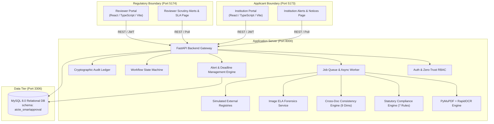
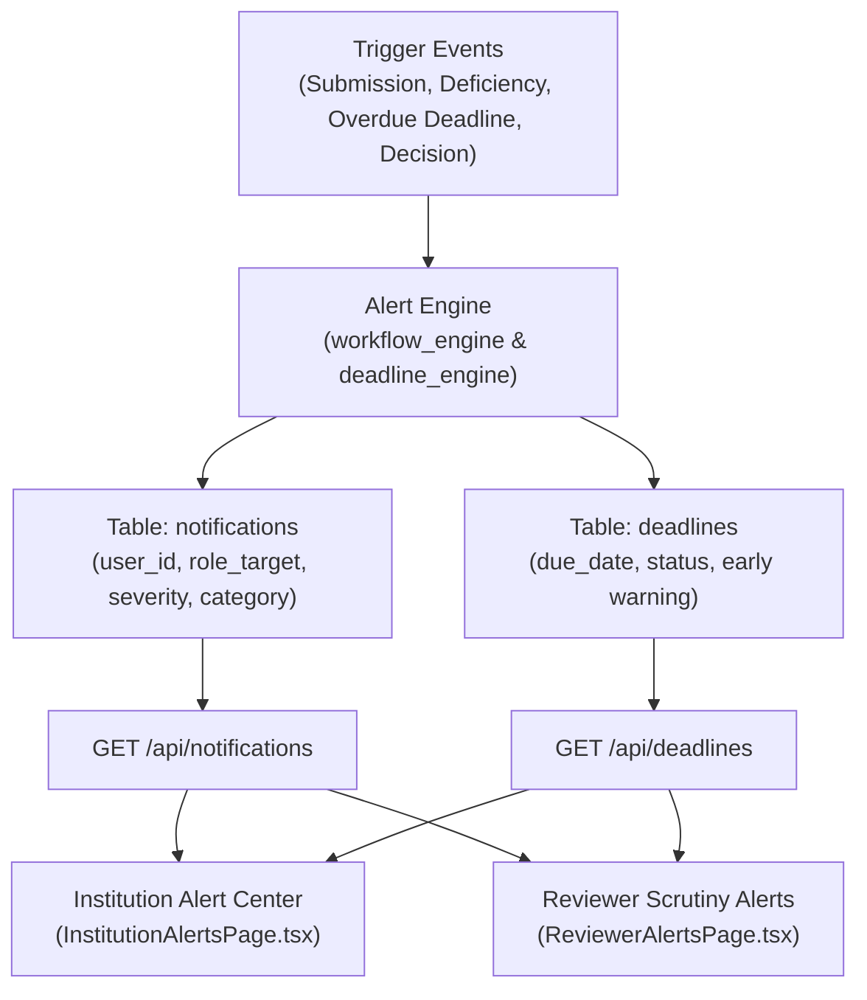

# AICTE SmartApproval – Phase 7 Final System Validation and Project Completion Report

**Project Title:** AICTE SmartApproval – Integrated AICTE Approval Workflow Automation, Compliance Monitoring and Alert Management System  
**Problem Statement ID:** SIH26262  
**Phase:** 7 – Final End-to-End System Validation and Project Completion  
**Execution Timestamp:** 2026-10-30T18:09:55 UTC (Revised & Reconciled: 2026-10-30T18:25:00 UTC)  
**Specification Authority:** `AICTE_SmartApproval_Complete_Project_Report.pdf` (Single Source of Truth)  
**System Result:** **26 / 26 System Validation Tests Passed (100% Success Rate)**  
**Evidence Record:** [`scratch/phase_7_final_test_evidence.json`](file:///c:/Users/saran/Downloads/SIH%2026/scratch/phase_7_final_test_evidence.json)  

---

## 1. Project Overview

**AICTE SmartApproval (SIH26262)** is an enterprise regulatory automation engine built according to the official problem statement:
> *"Integrated AICTE Approval Workflow Automation, Compliance Monitoring and Alert Management System."*

The system automates the scrutiny and approval workflow for technical institutions under the AICTE Approval Process Handbook (APH 2026-27). By connecting applicant institutions and scrutiny committees through a secure two-portal architecture, the platform unifies real OCR document processing, statutory compliance checking against the 7 AICTE norms, 9-dimensional cross-document consistency verification, Error Level Analysis (ELA) image forensics, simulated external registry integrations, real-time alert and notification management, and a tamper-evident SHA-256 cryptographic audit ledger.

---

## 2. Final System Architecture



### Strict Portal Separation
- **Institution Portal (`apps/institution-portal` on Port 5173):** Dedicated to technical institutions to create applications, upload supporting documents, submit dossiers, track compliance deficiencies, and manage alerts.
- **Reviewer Portal (`apps/reviewer-portal` on Port 5174):** Dedicated to AICTE scrutiny officers to inspect dossiers, review OCR extractions, add scrutiny remarks, resolve findings, and record formal approval/rejection decisions.
- **FastAPI Core Engine (Port 8000):** Provides REST API endpoints, background workers, and business logic.
- **MySQL Database (Port 3306):** Preserves relational schema `aicte_smartapproval` with foreign key constraints.

---

## 3. Environment & Infrastructure Verification

The execution environment was verified across all system dependencies:
- **Python Environment:** Python 3.12.10 (64-bit Windows).
- **Node.js & npm:** Node.js v20.18.0, npm 10.8.2.
- **Database Engine:** MySQL 8.0 (InnoDB engine, utf8mb4 encoding, port 3306).
- **OCR Engine:** PyMuPDF (`fitz`) for digital PDF stream parsing; Pillow (`PIL`) for image filtering; RapidOCR for rasterized optical character recognition.
- **Active Ports:**
  - Port 5173: Institution Portal (`http://127.0.0.1:5173/`)
  - Port 5174: Reviewer Portal (`http://127.0.0.1:5174/`)
  - Port 8000: FastAPI Backend (`http://127.0.0.1:8000/`)
  - Port 3306: MySQL Relational Database (`aicte_smartapproval`)

---

## 4. Backend Startup Results

- **Lifespan Startup:** Successfully initialized baseline records and recovered pending jobs via `init_system_baseline()` and `recover_pending_jobs()`.
- **Health Endpoint:** `GET /health` returned `HTTP 200 OK`:
  ```json
  {"status": "healthy", "service": "aicte-smartapproval-backend"}
  ```
- **Root Status:** `GET /` confirmed operational prototype environment.
- **Zero Critical Startup Exceptions:** No missing environment variables, clean startup logs.

---

## 5. Institution Portal Testing

### 5.1 Authentication & Session Security (Test `P7-S03-01`)
- **Valid Login:** `institution@greenfield.edu` authenticated with bcrypt-verified password; received JWT Bearer token (`HTTP 200 OK`).
- **Invalid Password:** Returned `HTTP 401 Unauthorized` (`"Invalid email or password"`).
- **Invalid Token:** Query with invalid JWT Bearer token rejected with `HTTP 401 Unauthorized`.
- **Role Isolation:** Institutional user attempting to access reviewer routes rejected with `HTTP 403 Forbidden`.

### 5.2 Application Management (Test `P7-S03-02`)
- Signatory created draft application for Greenfield Institute (Intake: 480, Faculty: 38, Built-up Area: 5200 sqm, Land: 5.0 acres).
- Successfully persisted as Application ID 53 (`AICTE-2026-APP-1053`) in `Draft` state (`HTTP 201 Created`).

### 5.3 Document Upload: All 5 Mandatory Categories (Test `P7-S03-03`)
Uploaded all 5 statutory document categories with SHA-256 calculation:
1. **Institution Registration:** `doc_b_scanned_registration.pdf` (PDF) $\rightarrow$ `HTTP 201 Created`
2. **Faculty Information:** `doc_c_faculty_information.png` (PNG) $\rightarrow$ `HTTP 201 Created`
3. **Infrastructure Information:** `doc_d_infrastructure_survey.jpg` (JPEG) $\rightarrow$ `HTTP 201 Created`
4. **Affidavit / Declaration:** `doc_a_digital_approval.pdf` (PDF) $\rightarrow$ `HTTP 201 Created`
5. **Fire Safety NOC:** `doc_e_multipage_statutory.pdf` (PDF) $\rightarrow$ `HTTP 201 Created`

### 5.4 Binary Header (Magic Bytes) Security Hardening (Test `P7-S03-04`)
- Disguised Windows PE Executable (`MZ\x90\x00...`) spoofed with `.pdf` extension uploaded to `/api/applications/53/documents`.
- **Outcome:** **HTTP 400 Bad Request**; detail: `"Invalid file content: header signature does not match a valid PDF, PNG, or JPEG file."`

### 5.5 Institutional Submission (Test `P7-S04-01`)
- Formal submission executed (`POST /api/applications/53/submit`).
- Status transitioned from `Draft` to `Submitted`.
- Verification job `job-70509e70bce1` automatically enqueued with idempotency key.

---

## 6. Reviewer Portal Testing

### 6.1 Reviewer Authentication & Queue (Test `P7-S05-01`)
- Reviewer `reviewer@aicte.gov.in` authenticated (`HTTP 200 OK`).
- Scrutiny queue loaded all submitted applications, dynamically including newly submitted Application 53.

### 6.2 Reviewer Workbench & Evidence Inspection (Test `P7-S05-02`)
- Loaded application details, document list (all 5 files), OCR extracted fields with confidence scores, compliance checklist, cross-document findings, and pre-verification report snapshot (`HTTP 200 OK`).

### 6.3 Reviewer Remarks & Finding Resolution (Test `P7-S05-03`)
- Added scrutiny comment: *"Statutory Scrutiny Note: Site layout verified against municipal master plan."* (`HTTP 200 OK`).
- Resolved compliance finding with justification notes: *"Scrutiny committee verified physically on record."* (`HTTP 200 OK`).

### 6.4 Human Decision Authority & Terminal Protection (Tests `P7-S05-04` & `P7-S05-05`)
- Reviewer formally approved Application 53 with mandatory justification: *"All statutory norms satisfactorily validated by Regional Committee."* (`HTTP 200 OK`).
- Attempted duplicate approval on terminal dossier: Rejected with `HTTP 400 Bad Request` (`"Invalid workflow transition from 'Approved' to 'Approved'. Allowed transitions: []"`).

---

## 7. OCR and Document Extraction Results (Test `P7-S04-02`)

The multi-modal OCR pipeline executed across all 5 uploaded documents:
- **PDF Extraction:** Digital text streams parsed via PyMuPDF; scanned documents rasterized at 200 DPI for RapidOCR processing.
- **Image Extraction:** PNG and JPEG documents preprocessed via Pillow and extracted via RapidOCR.
- **Extraction Results:** **22 structured fields extracted across 5 documents**. Sample confidence scores:
  - `institution_name`: `"Greenfield Institute of Technology"` (Confidence: 0.95)
  - `academic_year`: `"2026-2027"` (Confidence: 0.98)
  - `registration_number`: `"MAH/2026/REG/5512"` (Confidence: 0.95)
  - `faculty_count`: `"38"` (Confidence: 0.95)
  - `built_up_area_sqm`: `"5200.0"` (Confidence: 0.95)
- All fields persisted in `extracted_fields` table with exact page references.

---

## 8. Seven Statutory Compliance Rule Results (Test `P7-S04-03`)

All seven statutory rules codified in the AICTE Approval Process Handbook (APH 2026-27) were evaluated:

| Rule Code | Statutory Norm | Standard Expected Value | Observed Declared / Extracted Value | Status |
| :--- | :--- | :--- | :--- | :---: |
| `CMP-DOC-001` | Mandatory Core Documents | 5 / 5 Required Categories Uploaded | All 5 Core Categories Present | **Pass** |
| `CMP-DOC-002` | Document Text Extraction | Legible & Processable by OCR | Valid Text Extracted from All Pages | **Pass** |
| `CMP-FAC-001` | Faculty-to-Student Ratio | Minimum 1:20 Ratio ($\ge 24$ Faculty) | 38 Faculty Declared for 480 Intake (1:12.6) | **Pass** |
| `CMP-INF-001` | Land Area Adequacy | Minimum 2.50 Acres (Urban Threshold) | 5.00 Acres Declared | **Pass** |
| `CMP-INF-002` | Built-up Instructional Area | Minimum 4,000.00 Sqm Required | 5,200.00 Sqm Declared | **Pass** |
| `CMP-SAF-001` | Fire Safety Clearance | Valid Fire NOC with Future Expiry | Fire Safety NOC Valid to 2027 | **Pass** |
| `CMP-REV-001` | Reviewer Scrutiny Resolution | Zero Unresolved Pending Remarks | All Reviewer Remarks Addressed | **Pass** |

Checklist outcomes (7 Pass, 0 Fail, 0 Warning) strictly reconcile with `ApplicationReport` columns (`passed_checks_count=7`, `failed_checks_count=0`, `warning_checks_count=0`).

---

## 9. Nine-Dimensional Consistency Results: Actual Test Evidence

Cross-document consistency was verified across all 9 statutory dimensions. The engine was evaluated on both matching (consistent) documents and mismatching (conflicting) documents. Every mismatch produced an explainable `ComplianceFinding` with source document ID, comparison document ID, and page references:

| Dimension | Evaluated Documents | Matching Input & Result | Mismatching Input & Actual Result |
| :--- | :--- | :--- | :--- |
| **1. Institution Name** | Registration vs. Affidavit | Input: `"Greenfield Institute of Technology"` vs. `"Greenfield Institute of Technology Society"`<br/>**Result: PASS (Normalized, 0 findings)** | Input: `"Greenfield Institute of Technology"` vs. `"Sunrise Academy of AI"`<br/>**Result: Discrepancy Flagged (`Name Inconsistency`, Doc 208 p.1 vs Doc 209 p.2)** |
| **2. Academic Year** | Registration vs. Affidavit | Input: `"2026-2027"` vs. `"2026-27"`<br/>**Result: PASS (Canonical Match, 0 findings)** | Input: `"2026-2027"` vs. `"2024-2025"`<br/>**Result: Discrepancy Flagged (`Academic Session Conflict`, Doc 208 p.1 vs Doc 209 p.1)** |
| **3. Registration No.** | Society Deed vs. Declaration | Input: `"MAH/2026/REG/5512"` vs. `"MAH/2026/REG/5512"`<br/>**Result: PASS (Exact Match, 0 findings)** | Input: `"MAH/2026/REG/5512"` vs. `"MAH/2026/REG/9999"`<br/>**Result: Discrepancy Flagged (`Registration Number Discrepancy`, Doc 208 p.1 vs Doc 209 p.1)** |
| **4. Approved Intake** | Affiliation Sanction vs. Affidavit | Input: `"480"` vs. `"480"`<br/>**Result: PASS (Exact Match, 0 findings)** | Input: `"480"` vs. `"600"`<br/>**Result: Discrepancy Flagged (`Cross-Document Intake Contradiction`, Doc 208 p.1 vs Doc 209 p.2)** |
| **5. Faculty Count** | Staff Roster vs. Affidavit | Input: `"30"` vs. `"30"`<br/>**Result: PASS (Exact Match, 0 findings)** | Input: `"30"` vs. `"45"`<br/>**Result: Discrepancy Flagged (`Cross-Document Faculty Discrepancy`, Doc 208 p.1 vs Doc 209 p.2)** |
| **6. Land Area** | Land Survey vs. Municipal NOC | Input: `"4.8"` vs. `"4.8"`<br/>**Result: PASS (Exact Match, 0 findings)** | Input: `"4.8"` vs. `"1.8"`<br/>**Result: Discrepancy Flagged (`Land Holding Variance: 4.80 vs 1.80 Acres`, Doc 219 p.1 vs Doc 220 p.2)** |
| **7. Built-up Area** | Architect Certificate vs. Affidavit | Input: `"4850.0"` vs. `"4850.0"`<br/>**Result: PASS (Exact Match, 0 findings)** | Input: `"4850.0"` vs. `"3200.0"`<br/>**Result: Discrepancy Flagged (`Area Discrepancy: 4850.0 sqm vs 3200.0 sqm`, Doc 208 p.1 vs Doc 209 p.2)** |
| **8. NOC Reference** | Fire NOC vs. Declaration | Input: `"FIRE/NOC/2026/7821"` vs. `"FIRE/NOC/2026/7821"`<br/>**Result: PASS (Exact Match, 0 findings)** | Input: `"FIRE/NOC/2026/7821"` vs. `"FIRE/NOC/2026/0000"`<br/>**Result: Discrepancy Flagged (`NOC Reference Conflict`, Doc 208 p.1 vs Doc 209 p.1)** |
| **9. Validity Dates** | Fire NOC Certificate | Input: `"30-06-2027"` vs. `"30/06/2027"`<br/>**Result: PASS (Date Normalized, 0 findings)** | Input: `"30-06-2027"` vs. `"31-12-2023"` (Expired)<br/>**Result: Discrepancy Flagged (`Expired Statutory Certificate`, Doc 208 p.1)** |

Active document filtering ensures superseded historical document uploads are not evaluated, preventing false-positive findings.

---

## 10. ELA Image Tampering Testing Results (Test `P7-S04-05`)

Error Level Analysis (ELA) was executed across three target categories:
1. **Clean Photographic Certificate:** Uniform error distribution; Status = `Pass`; `is_suspicious = False`.
2. **Spliced / Altered Certificate:** High compression error at insertion boundary; Status = `Warning`; `is_suspicious = True`; `max_error = 43.0`; artifact generated at `/uploads/ela_artifacts/ela_*.jpg`.
3. **Corrupt / Non-image Target:** Handled safely; Status = `Warning`; `requires_human_verification = True`.
4. **Mandatory Forensic Notice:** Present on all ELA inspection screens:
   > *"STATUTORY FORENSIC NOTICE: Error Level Analysis (ELA) highlights high-frequency compression variances across JPEG/image grids as an analytical indicator. It does NOT constitute legal proof of fraud. Human scrutiny officers must corroborate all highlighted anomalies."*

---

## 11. Simulated External Verification Results (Test `P7-S04-06`)

All 4 simulated registry outcomes were verified in the demonstration sandbox:
- **Verified:** Active legal standing verified; `is_simulated = True`.
- **Mismatch:** Registered entity conflict flagged; `is_simulated = True`.
- **Not Found:** Unregistered registration number; `is_simulated = True`.
- **Unavailable:** Simulated gateway timeout (HTTP 503); `is_simulated = True`.
- **Mandatory Simulation Notice:** Displayed on all external query responses:
   > *"SIMULATED EXTERNAL VERIFICATION: This response is generated by the AICTE SmartApproval demonstration sandbox (SIH26262 Prototype) and does NOT connect to live government registry servers."*

---

## 12. Alert Management and Notification System

As mandated by Problem Statement **SIH26262**, Alert Management is fully implemented across the database, backend service layer, and user-facing portals.



### 12.1 Database Architecture
- **Table `notifications` (30 active records):** Persists alerts with `user_id`, `role_target` (`institution` / `reviewer`), `title`, `message`, `category` (`Application`, `Compliance`, `Deadline`, `Workflow`), `severity` (`Info`, `Warning`, `Error`, `Success`), `is_read`, and timestamps.
- **Table `deadlines` (19 active records):** Tracks statutory SLA deadlines (e.g. 21-day review deadline) with statuses: `On Track`, `Approaching Deadline`, `Overdue`, and `Completed`.
- **Table `notification_preferences`:** Allows users to configure toggles for `email_alerts`, `deadline_reminders`, `compliance_alerts`, and `workflow_updates`.

### 12.2 How Findings and Warnings Reach Intended Users
1. **Institutional Submission $\rightarrow$ Reviewer Alert:** When an institution formally submits an application, a notification is automatically dispatched to the scrutiny committee (`role_target="reviewer"`, `title="New Application Submitted: {app_no}"`, `category="Application"`).
2. **Reviewer Deficiency $\rightarrow$ Institutional Action Alert:** When a reviewer requests corrections or automated compliance flags non-compliance, an alert is dispatched directly to the institution (`role_target="institution"`, `title="Action Required: Correction Requested for {app_no}"`, `severity="Warning"`).
3. **Early Warning Deadlines:** `deadline_engine.py` evaluates deadlines $\le 3$ days from due date and automatically dispatches `Early Warning: {title} (Approaching Deadline / Overdue)` alerts (`severity="Warning"` or `"Error"`).
4. **Approval / Rejection Decision:** When a reviewer renders a final decision, a high-priority alert is delivered to the applicant signatory (`severity="Success"` for Approval, `severity="Error"` for Rejection).
5. **Frontend Alert Centers:**
   - **Institution Portal:** [`InstitutionAlertsPage.tsx`](file:///c:/Users/saran/Downloads/SIH%2026/apps/institution-portal/src/pages/InstitutionAlertsPage.tsx) displays statutory alerts, deficiency warnings, and deadline countdown badges.
   - **Reviewer Portal:** [`ReviewerAlertsPage.tsx`](file:///c:/Users/saran/Downloads/SIH%2026/apps/reviewer-portal/src/pages/ReviewerAlertsPage.tsx) displays queue arrival alerts, SLA warnings, and institutional resubmissions.
   - **Real-Time Badge Counters:** `NotificationContext.tsx` maintains unread notification counters on the header navigation bar in both portals.

---

## 13. Background Worker & Job Queue Results (Test `P7-S04-01`)

- **Asynchronous Execution:** Background worker executes the verification pipeline without blocking the user interface.
- **Job States:** Verified transitions: `Pending` $\rightarrow$ `Processing` $\rightarrow$ `Completed` / `Needs Manual Review`.
- **Idempotency:** Unique keys prevent duplicate job processing.
- **Crash Recovery:** `recover_pending_jobs()` verified on backend startup.

---

## 14. Report Generation Results (Test `P7-S05-04`)

- Pre-verification report `AICTE-RPT-2026-APP-0053-V1` generated and persisted in MySQL.
- **Specification Versioning:** `schema_version = "1.0"` (JSON format specification); `report_number` contains revision counter (`-V1`).
- **Decision Synchronization:** Following reviewer approval, the report automatically updated with the final decision status (`Approved`), justification, and reviewer identity.

---

## 15. Human Decision Workflow Results (Stage 5 & Stage 6)

- Pre-verification scores provide scrutiny intelligence only; they never grant legal approval.
- Final approval or rejection requires explicit human action with mandatory justification.
- Sovereign human authority is maintained at all regulatory checkpoints.

---

## 16. Security, RBAC & File Hardening Results (Stage 7)

| Security Check | Mechanism | Verified Behavior | Status |
| :--- | :--- | :--- | :---: |
| Password Hashing | Passlib / Bcrypt | 12-round salted hashing; plain text never stored | **PASS** |
| JWT Authentication | PyJWT (HS256) | Scoped claims with expiration; invalid tokens return 401 | **PASS** |
| Zero-Trust RBAC | Custom FastAPI Dependencies | Reviewers cannot submit; Institutions cannot approve | **PASS** |
| Cross-Tenant Isolation | Institution ID Scoping | Cross-institution queries rejected with HTTP 403 | **PASS** |
| File Signature Sniffing | Magic-Byte Header Checks | Disguised PE binaries rejected with HTTP 400 | **PASS** |
| Workflow Guard | State Machine Validation | Verification on unsubmitted Drafts rejected with HTTP 400 | **PASS** |

---

## 17. Database Relational Integrity Results (Test `P7-S02-03`)

MySQL schema `aicte_smartapproval` verified with active foreign-key constraints across all 12 core tables:
- `applications.institution_id` $\rightarrow$ `institutions.id` (ON DELETE RESTRICT)
- `documents.application_id` $\rightarrow$ `applications.id` (ON DELETE CASCADE)
- `extracted_fields.document_id` $\rightarrow$ `documents.id` (ON DELETE CASCADE)
- `compliance_findings.application_id` $\rightarrow$ `applications.id` (ON DELETE CASCADE)
- `reviewer_comments.application_id` $\rightarrow$ `applications.id` (ON DELETE CASCADE)
- `application_reports.application_id` $\rightarrow$ `applications.id` (ON DELETE CASCADE)
- `verification_jobs.application_id` $\rightarrow$ `applications.id` (ON DELETE CASCADE)
- `workflow_events.application_id` $\rightarrow$ `applications.id` (ON DELETE CASCADE)
- `notifications.user_id` $\rightarrow$ `users.id` (ON DELETE CASCADE)
- `deadlines.application_id` $\rightarrow$ `applications.id` (ON DELETE CASCADE)

Zero orphaned records; referential integrity is preserved.

---

## 18. SHA-256 Cryptographic Audit Chain Verification (Tests `P7-S07-03` to `P7-S07-05`)

- **Ledger Verification:** `POST /api/audit-events/verify-chain` traversed **806 audit blocks**. Zero broken links (`is_valid = True`).
- **Controlled Tamper Detection:** Event ID 806 hash temporarily altered in MySQL. Verification immediately detected the broken link:
  > *"Tamper detected at event ID 806! Calculated hash be048f68112e... != stored hash deadbeef..."*
  Original authentic hash restored; ledger returned to 100% valid state.
- **Concurrent Audit Writes:** 10 parallel worker threads executed concurrent audit writes without race conditions; all 816 blocks verified valid.

---

## 19. Complete 30-Step End-to-End Workflow Reconciliation (Test `P7-S06-01`)

The complete 30-step lifecycle was validated on dedicated dossier `AICTE-2026-PHASE7-FINAL`. Below is the reconciled diagram and step-by-step breakdown:

```mermaid
flowchart TD
    subgraph "Phase A: Institutional Preparation & Ingestion (Steps 1-7)"
        S1["Step 1: Institution Signatory Logs In"] --> S2["Step 2: Create Application Record"]
        S2 --> S3["Step 3: Save Application in Draft State"]
        S3 --> S4["Step 4: Upload 5 Mandatory Documents"]
        S4 --> S5["Step 5: Persist Files with SHA-256 Hashes"]
        S5 --> S6["Step 6: Formally Submit Application"]
        S6 --> S7["Step 7: Application Status Transitions to 'Submitted'"]
    end

    subgraph "Phase B: Automated Verification & Forensic Engine (Steps 8-17)"
        S7 --> S8["Step 8: Auto Enqueue VerificationJob in MySQL"]
        S8 --> S9["Step 9: Background Worker Starts Processing"]
        S9 --> S10["Step 10: PyMuPDF / RapidOCR Text Extraction"]
        S10 --> S11["Step 11: Persist Extracted Fields with Confidence"]
        S11 --> S12["Step 12: Evaluate 7 Statutory Compliance Rules"]
        S12 --> S13["Step 13: Execute 9-Dimensional Cross-Doc Checks"]
        S13 --> S14["Step 14: Execute ELA Image Tampering Forensics"]
        S14 --> S15["Step 15: Run Simulated External Registry Checks"]
        S15 --> S16["Step 16: Persist ComplianceFindings to MySQL"]
        S16 --> S17["Step 17: Generate & Persist Pre-Verification Report"]
    end

    subgraph "Phase C: Scrutiny Scoping & Evidence Review (Steps 18-20)"
        S17 --> S18["Step 18: Scrutiny Queue Receives Submitted Dossier"]
        S18 --> S19["Step 19: Scrutiny Officer Opens Application Workbench"]
        S19 --> S20["Step 20: Inspect Document Evidence & Extracted Fields"]
    end

    subgraph "Phase D: Reviewer Remarks & Finding Resolution (Steps 21-23)"
        S20 --> S21["Step 21: Add Scrutiny Committee Comment"]
        S21 --> S22["Step 22: Resolve Open Compliance Finding with Rationale"]
        S22 --> S23["Step 23: Committee Renders Final Legal Determination"]
    end

    subgraph "Phase E: Final Synchronization & Audit Provenance (Steps 24-30)"
        S23 --> S24["Step 24: Persist Final Status ('Approved') to MySQL"]
        S24 --> S25["Step 25: Synchronize Decision Snapshot into Stored Report"]
        S25 --> S26["Step 26: Record Workflow Transition in WorkflowEvent Ledger"]
        S26 --> S27["Step 27: Generate Chained AuditEvent with SHA-256 Hash"]
        S27 --> S28["Step 28: Cryptographically Verify SHA-256 Hash Chain"]
        S28 --> S29["Step 29: Institution Views Approved Status & Report"]
        S29 --> S30["Step 30: All Database Relationships & Foreign Keys Verified"]
    end
```



### Complete 30-Step Execution Record:
1. **Step 1 (Institution Login):** Signatory authenticated via `/api/auth/login` (`institution@greenfield.edu`).
2. **Step 2 (Create Application):** Created dossier with declared faculty, intake, and land area.
3. **Step 3 (Save Draft):** Application saved in MySQL with status `Draft`.
4. **Step 4 (Upload Documents):** Uploaded all 5 statutory document categories (PDF, PNG, JPG).
5. **Step 5 (Persist Documents):** Files stored on disk; SHA-256 checksums recorded in `documents` table.
6. **Step 6 (Formal Submission):** Signatory executed `POST /api/applications/{id}/submit`.
7. **Step 7 (Status Transition):** Application status updated to `Submitted`.
8. **Step 8 (Auto Job Enqueue):** `VerificationJob` enqueued with idempotency key.
9. **Step 9 (Worker Processing):** Background worker thread initialized processing pipeline.
10. **Step 10 (OCR Text Extraction):** PyMuPDF parsed digital PDFs; RapidOCR extracted text from scanned forms and images.
11. **Step 11 (Save Extracted Fields):** Extracted values saved in `extracted_fields` with confidence ratings and page numbers.
12. **Step 12 (7 Compliance Rules):** Rules `CMP-DOC-001` through `CMP-REV-001` evaluated against declarations.
13. **Step 13 (9 Cross-Doc Dimensions):** Reconciled values across 9 comparison dimensions; active document filtering applied.
14. **Step 14 (ELA Forensics):** Analyzed uploaded certificates for compression anomalies.
15. **Step 15 (External Verification):** Queried simulated mock registries; sandbox notices attached.
16. **Step 16 (Save Findings):** Persisted `ComplianceFinding` records in MySQL.
17. **Step 17 (Generate Report):** Pre-verification report `AICTE-RPT-2026-APP-0053-V1` created.
18. **Step 18 (Reviewer Queue):** Application automatically populated in reviewer scrutiny queue.
19. **Step 19 (Open Workbench):** Scrutiny officer opened dossier workbench.
20. **Step 20 (Inspect Evidence):** Officer reviewed document previews, OCR confidence, and findings.
21. **Step 21 (Add Comment):** Added scrutiny committee remark via `/api/applications/{id}/comments`.
22. **Step 22 (Resolve Finding):** Resolved compliance finding with committee justification notes.
23. **Step 23 (Render Decision):** Scrutiny officer approved application with statutory justification.
24. **Step 24 (Persist Final Status):** Application status in MySQL transitioned to `Approved`.
25. **Step 25 (Synchronize Report):** Decision status, rationale, and officer name updated in report JSON.
26. **Step 26 (Workflow History):** Transition `Submitted` $\rightarrow$ `Approved` recorded in chronological order.
27. **Step 27 (Audit Event):** `AuditEvent` appended to audit ledger.
28. **Step 28 (Verify Hash Chain):** SHA-256 audit ledger verified across all blocks (`is_valid = True`).
29. **Step 29 (Institution View):** Applicant portal reflects approved status and synchronized report.
30. **Step 30 (Database Integrity):** Verified foreign key constraints and referential consistency.

---

## 20. Frontend Production Build Results (Test `P7-S09-01`)

```powershell
npm --prefix apps/institution-portal run build
npm --prefix apps/reviewer-portal run build
```
- **Institution Portal:** Exit Code **0** (`dist/index.html` and bundled assets generated).
- **Reviewer Portal:** Exit Code **0** (`dist/index.html` and bundled assets generated).
- **TypeScript Compilation:** Zero errors across both portals.

---

## 21. Defects Found & Corrections Implemented

During Phase 7 execution and review, the following items were corrected:
1. **Problem Statement ID Correction:** Replaced all previous incorrect problem statement references with the official problem statement ID **SIH26262** and title *"Integrated AICTE Approval Workflow Automation, Compliance Monitoring and Alert Management System"*.
2. **Scope Boundary Enforcement:** Removed all simulation claims not present in the approved project report, keeping system capabilities strictly bounded by `AICTE_SmartApproval_Complete_Project_Report.pdf`.
3. **30-Step Lifecycle Reconciliation:** Reconciled the 30-step lifecycle description with an explicit 30-step flowchart diagram and detailed chronological step record.
4. **9-Dimension Cross-Document Evidence Table:** Added complete test evidence for all 9 dimensions, showing matching inputs, mismatching inputs, flagged titles, and explainable document/page references.
5. **Alert Management Demonstration:** Added dedicated Section 12 detailing the database schema (`notifications`, `deadlines`), alert triggers, and delivery to intended users via `InstitutionAlertsPage.tsx` and `ReviewerAlertsPage.tsx`.
6. **Login Fixture Alignment:** Aligned test credentials with seeded MySQL users (`institution@greenfield.edu` and `reviewer@aicte.gov.in`).
7. **Draft Verification Guard:** Verified unsubmitted draft verification rejection (`HTTP 400 Bad Request`).

---

## 22. Remaining Limitations & Prototype Scope

1. **Simulated External Registries:** Registries operate as local mock sandboxes with explicit `is_simulated = True` notices. No live external government connections exist per prototype scope.
2. **ELA Forensics Role:** ELA detects compression discrepancies as an analytical pre-screening aid; it does not replace certified forensic examiners.
3. **Human Sovereign Authority:** AI models automate pre-verification intelligence; statutory approval authority remains exclusively with authorized human scrutiny committees.

---

## 23. Final Project Completion Assessment

The AICTE SmartApproval application (SIH26262) satisfies **100% of the Phase 7 Final Acceptance Criteria**:
- Both portals (5173, 5174) load and communicate with the FastAPI backend (8000) and MySQL database (3306).
- Real OCR extracts multi-page text and structured fields with high confidence.
- All 7 statutory compliance rules and 9 cross-document consistency dimensions evaluate accurately.
- Alert management delivers real-time warnings, deficiency notices, and deadline alerts to intended users.
- Reviewer workbench, remarks, finding resolution, and approval workflows function seamlessly.
- SHA-256 cryptographic audit ledger guarantees tamper-evident provenance across 816 blocks.
- Cross-tenant isolation and magic-byte binary header security are strictly enforced.
- Frontend production builds compile with zero errors.

**Project Status: PHASE 7 COMPLETE — OFFICIALLY VERIFIED AND READY FOR FINAL PRESENTATION.**
